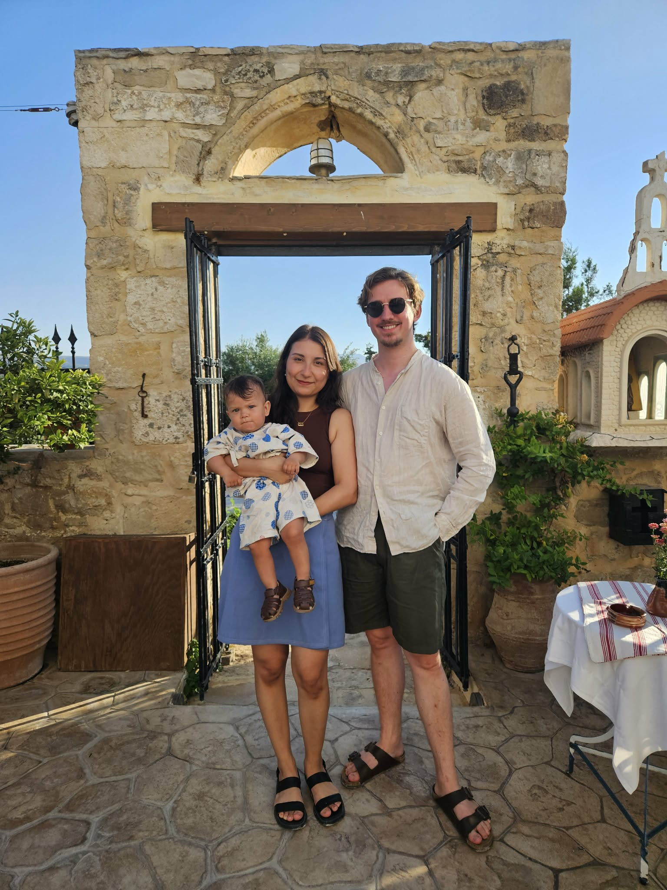

<section class="hero">
  

    <h1>Max & Natalie</h1>
    
Vi gifter oss og gleder oss til å feire dette sammen med alle vi er glad i!

    

      Sett av datoen
      <strong>Lørdag 17. Juli 2027</strong>
    

    <a class="text-link" href="//">Mer informasjon om den store dagen</a>
  

  <figure class="hero-photo">
    
    <figcaption></figcaption>
  </figure>
</section>

<section class="welcome">
  
Kjære familie og venner

  
Mer informasjon om progam kommer her. Vi gleder oss til å dele denne dagen med dere.

  
</section>